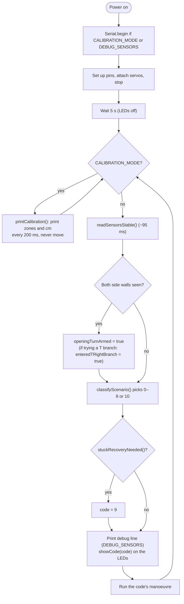
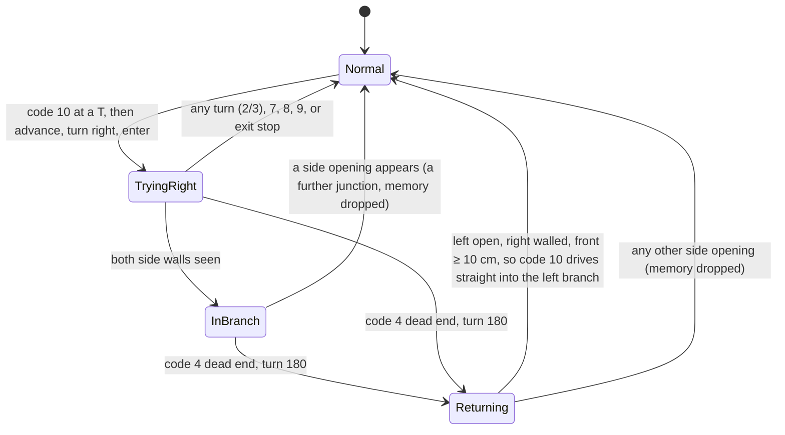

# ELEC1601 Essentials Robot — `ESSENTIAL.ino`

A two-servo robot with three IR sensors (left, front, right) that drives through a maze corridor. On every
pass of `loop()` it reads the sensors, picks one **scenario code (0–10)**, shows that code on three LEDs, and
runs that scenario's manoeuvre.

This README describes **exactly what the current code does**, so you can predict the robot, tune it, and
change it safely. Part 1 explains the behaviour, Part 2 is the configuration reference, and Part 3 is a guide
for anyone (human or AI agent) modifying the code.

> **Keep this file in sync.** Any change to `ESSENTIAL.ino` that changes behaviour, a constant's meaning or
> a default value must update the matching section here in the same change.

---

## Contents

- [Part 1 — Behaviour](#part-1--behaviour)
  - [Hardware](#hardware)
  - [Sensing: zones, cm and "open"](#sensing-zones-cm-and-open)
  - [Power-on and the main loop](#power-on-and-the-main-loop)
  - [Scenario codes at a glance](#scenario-codes-at-a-glance)
  - [How a scenario is chosen (exact order)](#how-a-scenario-is-chosen-exact-order)
  - [What each scenario does](#what-each-scenario-does)
  - [Memory: the state flags](#memory-the-state-flags)
  - [T-junction strategy (code 10)](#t-junction-strategy-code-10)
  - [Stuck detection (code 9)](#stuck-detection-code-9)
  - [Maze-exit stop](#maze-exit-stop)
  - [Known behaviours and limitations](#known-behaviours-and-limitations)
- [Part 2 — Configuration reference](#part-2--configuration-reference)
- [Part 3 — Guide for modifying the code (humans and AI agents)](#part-3--guide-for-modifying-the-code-humans-and-ai-agents)

---

# Part 1 — Behaviour

## Hardware

| Part | IR LED pin | IR receiver pin | Indicator LED pin |
|---|---|---|---|
| Left sensor | 10 | 11 | A2 (left LED) |
| Front (middle) sensor | 6 | 7 | A1 (middle LED) |
| Right sensor | 2 | 3 | A0 (right LED) |

| Servo | Pin | Stop | Forward | Backward |
|---|---|---|---|---|
| Left wheel | 13 | 1500 µs | 1570 µs | 1430 µs |
| Right wheel | 12 | 1493 µs | 1428 µs | 1558 µs |

- **Spinning on the spot:** both servos get the same value. 1600 µs spins the robot **clockwise** (right),
  and 1400 µs spins it **anticlockwise** (left).
- **Serial:** pins 0/1 are free. Serial runs at 9600 baud whenever `CALIBRATION_MODE` or `DEBUG_SENSORS` is true.

## Sensing: zones, cm and "open"

1. **Zone.** `irDistance()` flashes the IR LED at 38, 39, 40, 41 and 42 kHz and counts how many frequencies
   see **no** reflection. The result is a zone from 0 to 5: 0 means very close, and 5 means nothing seen.
   One sweep of one sensor takes about 10 ms.
2. **cm.** Each sensor has its own zone → cm table (`LEFT_ZONE_CM`, `MIDDLE_ZONE_CM`, `RIGHT_ZONE_CM`).
   All the decision thresholds are written in cm, compared against these table values.
3. **Open.** A side or the front is **open** when its raw zone is 5 (nothing seen). This is decided from the
   zone itself, not from the cm table.

**Default tables (placeholders, not yet measured).** All three sensors use the same table:

| Zone | 0 | 1 | 2 | 3 | 4 | 5 (open) |
|---|---|---|---|---|---|---|
| cm reported | 2 | 5 | 8 | 11 | 14 | 17 |

> Because a reading is always one of these table values, **every cm threshold really means "this zone or
> above/below"**. The "default-table meaning" columns below translate each threshold into zones. Once you
> measure real tables, re-check those translations.

**Two ways to read the sensors:**

| Function | How | Time | Used by |
|---|---|---|---|
| `readSensorsStable()` | median of 3 sweeps per sensor | ~95 ms | the decision at the start of every `loop()` pass |
| `readSensors()` | 1 sweep per sensor | ~32 ms | the checks *inside* moves (`driveCentred`, `advanceToOpening`) |
| `irDistanceStable(middleSensor)` | median of 3 sweeps, front only | ~32 ms | `rotateUntilParallel` (codes 7/8) |

## Power-on and the main loop

- **Start-up has no separate check.** Starting-position handling (codes 5–8) is controlled by the
  `startingPositionPhase` flag, which is true at power-on and switched off by the first real manoeuvre
  (see [state flags](#memory-the-state-flags)).
- **Debug line format** (`DEBUG_SENSORS = true`, the default):
  `L M R | open L/R a/b -> code N`, for example `11 17 11 | open L/R 0/0 -> code 1`. The values are in cm and the
  open flags are 1 or 0.
- **The LEDs change before the manoeuvre starts, and the robot moves immediately.** No code holds the robot
  still for display.

## Scenario codes at a glance

LEDs are listed as **Left (A2), Middle (A1), Right (A0)**. FLASH toggles every 1 s.

| Code | Name | LEDs | Manoeuvre (summary) |
|---|---|---|---|
| 0 | Unknown / stop | OFF OFF OFF | stop |
| 1 | Corridor | OFF OFF ON | drive 5 cm, steering, checking the front |
| 2 | Right turn | OFF ON OFF | (advance into opening) → spin 90° right → drive 5 cm in → stop |
| 3 | Left turn | OFF ON ON | (advance into opening) → spin 90° left → drive 5 cm in → stop |
| 4 | Dead end | ON OFF OFF | spin 180° clockwise |
| 5 | Close to left wall | ON OFF ON | 45° shuffle away from the left wall (start-up only) |
| 6 | Close to right wall | ON ON OFF | 45° shuffle away from the right wall (start-up only) |
| 7 | Angled towards left wall | ON ON ON | rotate right in small steps until the front is clear |
| 8 | Angled towards right wall | OFF OFF FLASH | rotate left in small steps until the front is clear |
| 9 | Stuck recovery | FLASH ON FLASH | reverse 5 cm and reset the start-up flags |
| 10 | T-junction | FLASH FLASH OFF | try the right branch, or, coming back, go straight into the left branch |

## How a scenario is chosen (exact order)

`classifyScenario(r)` runs these checks **in order, and the first match wins**. `L M R` are cm readings;
`Lopen Ropen Fopen` are the open flags. Defaults are shown with their default-table meaning in brackets.

> ⚠️ `classifyScenario()` is **not a pure function**. Steps 1, 4 and 6 change state (the exit-travel
> tracking and the T-branch memory).

| # | Check | Result |
|---|---|---|
| 1 | `mazeExitStopNeeded(r)`: all three open **and** (no wall seen since power-on **or** ≥ 15 cm driven forward while all open) | clear T memory → **0** |
| 2 | M, L, R all in 0–9 cm (zones 0–2) | **4** dead end |
| 3 | trying the T's right branch **and** already inside it **and** a side is open | clear T memory, continue |
| 4 | returning to the T **and** Lopen **and** right walled **and** M ≥ 10 cm (zone ≥ 3) | **10** (return path) |
| 5 | returning to the T **and** (Lopen or Ropen) | clear T memory, continue |
| 6 | `openingTurnArmed` **and** M in 0–9 (zone ≤ 2) **and** Lopen **and** Ropen | **10** (T-junction) |
| 7 | only while `startingPositionPhase`: angled-left test → **7**; angled-right test → **8**; close-left test **and** Fopen → **5**; close-right test **and** Fopen → **6** | 7 / 8 / 5 / 6 |
| 8 | Lopen **or** Ropen: if `openingTurnArmed` → **2** if Ropen, else **3** (right preferred). If not armed → **1** if M ≥ 10, else **0** | 2 / 3 / 1 / 0 |
| 9 | angled-left test | **7** |
| 10 | angled-right test | **8** |
| 11 | M in 0–9 **and** L in 0–15 **and** R > L | **2** |
| 12 | M in 0–9 **and** R in 0–15 **and** L > R | **3** |
| 13 | M ≥ 10 cm | **1** |
| 14 | anything else | **0** |

After step 8, both side walls are always visible, because any open side has already returned at step 8.

**The helper tests:**

| Test | Exact condition | Default-table meaning |
|---|---|---|
| angled-left (`angledTowards`) | `L ≤ leftTable[2]` and `M ≤ middleTable[2]` and `R > rightTable[2]` | L ≤ 8, M ≤ 8, R ≥ 11 (or open) |
| angled-right | mirror: `R ≤ rightTable[2]`, `M ≤ middleTable[2]`, `L > leftTable[2]` | R ≤ 8, M ≤ 8, L ≥ 11 (or open) |
| close-left (`closeToSide`) | left not open, `L < R`, and (`L ≤ 6` or `R − L > 6`) | left zone 0–1, or ≥ 3 zones closer than the right |
| close-right | mirror | mirror |

## What each scenario does

Times assume `FORWARD_MS_PER_CM = 75` and `TURN_TIME = 580 ms` (= 90°). Every turn uses
`turnInPlace`: stop, wait 200 ms, spin, stop, wait 200 ms.

### Code 1 — Corridor
1. Set `startingPositionPhase = false`.
2. `moveForwardCm(5)`: for up to 375 ms, repeatedly call `driveCentred()`, about every 32 ms. Each call:
   - **Maze exit** (see [Maze-exit stop](#maze-exit-stop)) → show 0, stop, end the step.
   - **Front < 10 cm** → stop, end the step.
   - **Right wall ≤ 6 cm** (and the left is open or further) → curve left (left wheel slowed by `STEER_AMOUNT`, 15 µs).
   - **Left wall ≤ 6 cm** (and the right is open or further) → curve right (right wheel slowed by 15 µs).
   - **Either side open** → straight.
   - **Otherwise, L − R > 6** → curve left; **L − R < −6** → curve right; else straight. With the default
     table, a correction needs a difference of 3 zones or more.
3. If the full 375 ms ran, set `hasCompletedForwardStep = true`.
4. **The wheels are not stopped at the end.** The robot keeps rolling during the next ~95 ms decision read
   (≈ 1.3 cm), without a front check.

### Codes 2 and 3 — Turns (`takeOpeningTurn`)
They fire from step 8 (an open side, while armed) or from steps 11/12 (both walls visible, front blocked).
1. Clear the T memory, and set `startingPositionPhase = false`.
2. **If the turning side is open** (step 8 case):
   - `advanceToOpening()`: drive straight, with no steering, for up to **760 ms (~10 cm)**.
     - It stops early once the front reads ≤ 6 cm on **2 consecutive** single reads.
     - A maze exit cancels the turn (show 0, stop).
   - Then set `openingTurnArmed = false`, so the same opening won't trigger another turn.
3. Spin 90° (code 2 clockwise, code 3 anticlockwise): 980 ms including the settles.
4. `enterCorridorAfterTurn()`: one `moveForwardCm(5)` with all of code 1's checks, then **stop**.
5. Total ≈ 2.1 s with the advance, or ≈ 1.4 s without it.

### Code 4 — Dead end
1. Set `startingPositionPhase = false`.
2. If the robot was trying the T's right branch, set `returningToT = true`. Clear `tryingTRightBranch` and
   `enteredTRightBranch`.
3. Spin 180° clockwise: 1160 ms + settles = 1.56 s.

### Codes 5 and 6 — Close to a wall (start-up only)
Code 5 calls `shiftTowardsMiddle(clockwise, anticlockwise, |L−R|)`; code 6 is the mirror image. Afterwards
`startingPositionPhase = false`.
1. Spin 45° away from the near wall (290 ms).
2. Drive straight `forwardCm`:
   - `lateral = (|L−R| − 6) / 2`, so it only corrects the part outside the tolerance.
   - `forwardCm = lateral / sin 45°`, **clamped to 1.5 – 4.0 cm**.
3. Spin 45° back (290 ms).
4. Reverse `forwardCm × cos 45°`, so the robot ends level with where it started. Stop and settle.

| \|L−R\| (default table) | forward | sideways shift | reverse |
|---|---|---|---|
| 3 or 6 cm | 1.5 cm (112 ms) | ≈ 1.06 cm | ≈ 1.06 cm |
| 9 cm | 2.12 cm (159 ms) | ≈ 1.5 cm | ≈ 1.5 cm |
| ≥ 12 cm | 4.0 cm (300 ms, capped) | ≈ 2.83 cm | ≈ 2.83 cm |

### Codes 7 and 8 — Angled towards a wall (`rotateUntilParallel`)
Code 7 rotates clockwise; code 8 rotates anticlockwise. Both first clear the T memory. Code 8 does **not**
pause before moving.
1. Stop, wait 200 ms, and read the front (stable) as `initialFront`.
2. Repeat:
   - Read the front (stable, ~32 ms).
   - **Done (true)** if the front is ≥ 10 cm **and** at least one of these holds: `initialFront < 10`,
     the front improved, or `initialFront ≥ 16`. Codes 7/8 always start with the front ≤ 8, so in practice
     this means "front ≥ 10 cm".
   - **Give up** once 193 ms of spinning (`TURN_TIME / 3`, ≈ 30°) has been used. It returns whether the
     front is clear.
   - Otherwise spin one step of 24 ms (`TURN_TIME / 24`, ≈ 3.7°), stop, and wait 100 ms.
3. If it returned true, set `startingPositionPhase = false`. If false, the phase stays as it was, so
   7/8 can be chosen again on the next pass.

That's at most 9 steps, about 1.6 s. Front clearance is a practical stopping rule, not proof that the robot
is parallel.

### Code 9 — Stuck recovery
1. Clear the T memory, stop, and settle.
2. Reverse 5 cm (375 ms), stop, and settle.
3. Set `startingPositionPhase = true` and `openingTurnArmed = true`, and reset the stuck timer. The next passes
   re-decide from fresh readings and can use codes 5–8 again.

### Code 10 — T-junction
- **First visit:** clear the T memory, set `tryingTRightBranch = true`, then do exactly what code 2 does
  (advance, spin right, enter). If the advance is cancelled, clear the T memory again.
- **Returning** (`returningToT`): clear the T memory, set `openingTurnArmed = false`, then
  `enterCorridorAfterTurn()`. This drives 5 cm **straight ahead** into the original left branch, ignoring
  the stem that is now open on the left.

### Code 0 — Stop
`stopRobot()`. The robot re-reads ~95 ms later. A stationary robot normally keeps getting the same readings,
so code 0 lasts until something changes, or until [stuck detection](#stuck-detection-code-9) converts it
to code 9.

## Memory: the state flags

The robot is not memoryless: these globals carry information between passes.

| Flag | Starts | Set by | Cleared by | Effect |
|---|---|---|---|---|
| `startingPositionPhase` | true | code 9 | codes 1, 2, 3, 4, 5, 6, a first-visit code 10 (via `takeOpeningTurn`), and 7/8 when they succeed | enables 5/6, and gives 7/8 priority over side openings (step 7) |
| `openingTurnArmed` | true | `loop()` when both side walls are seen; code 9 | turning into an open side (codes 2/3/10); the code 10 return path | when false, open sides don't cause turns (step 8 drives on) and T detection (step 6) is off |
| `hasCompletedForwardStep` | false | any `moveForwardCm` that runs its full distance | never | stuck detection is disabled until it is true |
| `stuckCandidateSince` | 0 | first suspicious pass | any non-suspicious pass; firing code 9 | stuck timer |
| `hasSeenMazeWall` | false | any reading with a wall on at least one sensor | never | before it is set, "all open" means stop |
| `allOpenTravel`, `drivingForward`, `openForwardTimeMs`, `lastMotionUpdate` | false/0 | `drive()`, `mazeExitStopNeeded()` | a reading that sees any wall resets `openForwardTimeMs` | counts forward-driving time while all three sensors read open |
| `tryingTRightBranch` | false | code 10 first visit | `clearTBranchTrial()`, code 4 | robot is exploring the T's right branch |
| `enteredTRightBranch` | false | `loop()` when both walls are seen while trying the branch | `clearTBranchTrial()`, code 4 | the branch has properly started |
| `returningToT` | false | code 4 while trying the branch | `clearTBranchTrial()` | the next "left open, right walled, front clear" is the T |
| `shownCode`, `flashOn`, `lastFlashToggle` | 0/false/0 | `showCode`, `updateLeds` | — | LED display |

`clearTBranchTrial()` (which clears the three T flags) runs on codes 2, 3, 7, 8, 9 and 10, on a maze-exit stop,
and at classification steps 3 and 5.

## T-junction strategy (code 10)

A T-junction means the front is blocked (≤ 9 cm) with both sides open, while armed. The robot tries the
**right branch first**. If that branch is a simple straight dead end, it comes back and takes the
**original left branch**. Only one level is remembered.

## Stuck detection (code 9)

There are no wheel encoders, so `stuckRecoveryNeeded()` uses a time heuristic. A pass is **suspicious**
when all of the following hold:

- `hasCompletedForwardStep` is true, and the sensors don't all read open,
- **near an obstacle:** front < 10 cm, or either side ≤ 6 cm,
- **and either** the chosen code is 0, 5, 6, 7 or 8, **or** it is code 1 with a side ≤ 6 cm and |L−R| > 6 cm.

If passes stay suspicious without a break for **1.5 s** (`STUCK_DETECT_TIME_MS`), the code is replaced with
**9**. Because the manoeuvres between passes take time, this can happen after only a few passes.

## Maze-exit stop

When all three sensors read open:

- If **no wall has ever been seen** since power-on, the robot stops (code 0). **It must be placed where at
  least one sensor sees a wall.**
- Otherwise it keeps going until it has driven **15 cm** (`EXIT_CLEAR_TRAVEL_CM` × 75 ms of forward-driving
  time) with everything open, and then stops for good (code 0).
- Spinning, reversing and waiting don't count towards the 15 cm. Any reading with a wall resets the counter.

This check runs at the decision (step 1) and inside `driveCentred()` and `advanceToOpening()`.

## Known behaviours and limitations

Things the code does today that you might not expect:

1. **It turns into the first side opening it sees** (right if both are open), whenever `openingTurnArmed`
   is true. It doesn't follow a wall or remember a route, apart from the single-level T memory.
2. **Front blocked between two visible walls that are not 3 zones apart** (e.g. `11 / 5 / 11`, a wide dead
   end) matches nothing, so it gets code 0. If a forward step has been completed, this becomes code 9 after
   1.5 s: reverse 5 cm, drive forward, stop again. That can repeat indefinitely.
3. **Starting with nothing in view** gives a permanent code 0 (see maze-exit stop).
4. **All turns and distances are timed.** Their accuracy depends on `TURN_TIME`, `FORWARD_MS_PER_CM`,
   battery level and floor grip.
5. **The zone tables are placeholders.** With the default 3 cm spacing, all cm thresholds behave as the
   zone thresholds listed above.
6. **Codes 5/6 only happen during `startingPositionPhase`** and need the front fully open (zone 5).
   During normal driving, centring is only the steering inside `driveCentred()`.
7. **Defined but unused:** `wallDetected()`, `irDistanceCm()`, the `IrSensor.detectFrequency` field, and
   `CODE_8_SHOW_TIME`. Changing them has no effect.

---

# Part 2 — Configuration reference

All tunables are `const` globals at the top of `ESSENTIAL.ino`.

### Modes

| Constant | Default | Meaning |
|---|---|---|
| `CALIBRATION_MODE` | false | true: never drive. Print `zone L M R \| cm L M R` every 200 ms. |
| `DEBUG_SENSORS` | true | Print one line per `loop()` pass with the readings, open flags and chosen code. |

### Sensing

| Constant | Default | Meaning |
|---|---|---|
| `DISTANCE_FREQ_START / END / STEP` | 38000 / 42000 / 1000 Hz | the sweep; `NUM_ZONES` = (END−START)/STEP + 2 = **6** |
| `LEFT_ZONE_CM`, `MIDDLE_ZONE_CM`, `RIGHT_ZONE_CM` | {2,5,8,11,14,17} | cm for each zone. Must have exactly `NUM_ZONES` entries (checked by `static_assert`) and should increase. |

### Servo calibration

| Constant | Default | Meaning |
|---|---|---|
| `LEFT_SERVO_PIN`, `RIGHT_SERVO_PIN` | 13, 12 | |
| `LEFT_STOP`, `RIGHT_STOP` | 1500, 1493 | no creep when stopped |
| `LEFT_FORWARD`, `RIGHT_FORWARD` | 1570, 1428 | straight forward |
| `LEFT_BACKWARD`, `RIGHT_BACKWARD` | 1430, 1558 | straight backward |
| `STEER_AMOUNT` | 15 µs | how much the inside wheel is slowed when curving |
| `LEFT_TURN_SPEED`, `RIGHT_TURN_SPEED` | 1400, 1600 | spin anticlockwise / clockwise (both wheels) |
| `TURN_TIME` | 580 ms | spin time for 90°. **Derived from it:** `TURN_180_TIME` = 2×, `NUDGE_TURN_TIME` = 45/90×, `PARALLEL_MAX_TURN_TIME` = ⅓×, `PARALLEL_STEP_TIME` = 1/24× |
| `FORWARD_MS_PER_CM`, `BACKWARD_MS_PER_CM` | 75, 75 | drive 2000 ms, measure, then set to 2000 / cm |

### Motion

| Constant | Default | Used by | Meaning |
|---|---|---|---|
| `CORRIDOR_FORWARD_CM` | 5 | codes 1, 2, 3, 9, 10 | one forward step, the entry after a turn, and the stuck reverse |
| `OPENING_FORWARD_TIME_MS` | 760 | 2, 3, 10 | longest advance into an opening before turning (~10 cm) |
| `OPENING_FRONT_STOP_CM` | 6 (zone ≤ 1) | 2, 3, 10 | the advance stops when the front is ≤ this on 2 reads in a row |
| `NUDGE_ANGLE_DEG` | 45 | 5, 6 | shuffle angle |
| `NUDGE_MIN_FORWARD_CM`, `NUDGE_MAX_FORWARD_CM` | 1.5, 4.0 | 5, 6 | clamp on the diagonal drive |
| `EXIT_CLEAR_TRAVEL_CM` | 15 | exit stop | forward travel allowed with everything open |
| `STUCK_DETECT_TIME_MS` | 1500 | 9 | how long a suspicious state must last |
| `STARTUP_DELAY` | 5000 ms | setup | still, LEDs off |
| `SETTLE_DELAY` | 200 ms | turns, shuffles, recovery | pause around every spin (half of it between 7/8 steps) |

### Decision thresholds (cm)

| Constant | Default | Default-table meaning | Used by |
|---|---|---|---|
| `FRONT_CLEAR_MIN_CM` | 10 | front zone ≥ 3 | code 1, the stop inside `driveCentred`, steps 4/8/13, stuck test |
| `TURN_FRONT_MIN_CM`/`MAX` | 0 / 9 | front zone 0–2 | T (step 6), steps 11/12 |
| `TURN_SIDE_MIN_CM`/`MAX` | 0 / 15 | side zone 0–4 (any wall) | steps 11/12 |
| `DEAD_END_MIN_CM`/`MAX` | 0 / 9 | all zones 0–2 | code 4 |
| `CENTRE_TOLERANCE_CM` | 6 | ≥ 3 zones apart | codes 5/6, shuffle size |
| `STEER_TOLERANCE_CM` | 6 | ≥ 3 zones apart | steering in `driveCentred`, stuck test |
| `SIDE_CLEARANCE_MIN_CM` | 6 | side zone 0–1 | codes 5/6, steering off a near wall |
| `ANGLED_NEAR_MAX_CM` | 6 | side zone 0–1 | stuck test only |
| `ANGLED_MAX_ZONE` | 2 (a zone index, not cm) | near/front ≤ table[2], far > table[2] | codes 7/8 |
| `PARALLEL_FRONT_MIN_CM` | = `FRONT_CLEAR_MIN_CM` | front zone ≥ 3 | the stopping rule for 7/8 |
| `NO_OBJECT_MIN_CM` | 16 | zone 5 | 7/8 stopping rule (`initialFront ≥ 16`) |

### LEDs

| Constant | Default | Meaning |
|---|---|---|
| `LED_CODES[11][3]` | see the [codes table](#scenario-codes-at-a-glance) | `{left, middle, right}`; each is `LOW`, `HIGH` or `FLASH` |
| `FLASH_INTERVAL` | 1000 ms | flash toggle period |

### Calibration order

Do these in order, because later steps depend on earlier ones:

1. Stop values.
2. Forward values (drives straight).
3. Backward values.
4. `*_MS_PER_CM`.
5. `TURN_TIME` (exactly 90°).
6. **Zone tables:** set `CALIBRATION_MODE = true`, hold a wall at known distances in front of each sensor, and
   set each entry to the middle of the distances where that zone appeared. The last entry should be just
   beyond the furthest distance the sensor can see.
7. Re-check every decision threshold against the new tables. Put each threshold *between* two table values.
8. Recalibrate steps 4–5 on the batteries you will demo with.

---

# Part 3 — Guide for modifying the code (humans and AI agents)

### Before changing anything

- **Read all of `ESSENTIAL.ino`.** Behaviour is spread across `classifyScenario()` (ordered, with side
  effects), the `switch` in `loop()`, the state flags, and checks *inside* the manoeuvres
  (`driveCentred`, `advanceToOpening`).
- **Predict the change with the [exact order table](#how-a-scenario-is-chosen-exact-order).** A new check
  only takes effect if no earlier step already returned.
- **Don't change the hardware calibration** (pins, servo µs values, `TURN_TIME`, `*_MS_PER_CM`, zone tables)
  unless the user asks. These are measured on the physical robot.

### Rules the code depends on

| Rule | Why |
|---|---|
| Keep every `struct` (`IrSensor`, `Readings`) above the first function definition | The Arduino IDE inserts function prototypes before the first function; any type they use must already be declared. |
| Zone tables need exactly `NUM_ZONES` entries | `static_assert` fails otherwise. If you change the sweep constants, `NUM_ZONES` changes too. |
| "Open" means raw zone == `NUM_ZONES − 1` | Don't replace it with a cm comparison: an open reading is not a real distance. |
| Pick cm thresholds *between* table values | Readings are always table values, so a threshold equal to a table value is ambiguous to read. |
| Use `waitMs()` instead of `delay()` in movement code, and call `updateLeds()` inside any loop you write | Otherwise flashing LEDs (codes 8, 9, 10) freeze. `delay()` is only used in setup, `irDetect` (1 ms) and calibration mode. |
| Use `drive()` (or the wrappers) for every servo command | `drive()` keeps the exit-travel accounting (`drivingForward`, `openForwardTimeMs`) correct. |
| End every manoeuvre stopped, except a deliberate rolling step like code 1 | The next decision read takes ~95 ms and nothing checks the front during it. |
| Maintain the state flags | If a new manoeuvre counts as "past the starting position", clear `startingPositionPhase`. If it changes direction, decide whether to call `clearTBranchTrial()`. If it turns into an opening, decide about `openingTurnArmed`. |

### Recipes

**Add a new scenario code**
1. Add `SCENARIO_<NAME>_<N>`.
2. Add a row to `LED_CODES` and increase `LED_CODE_COUNT`. `FLASH` works in any column.
3. Insert its check in `classifyScenario()` at the right step. Ask what it could be confused with, and put the
   more specific check first.
4. Add a `case` in `loop()`. Build the manoeuvre from `drive`/`moveForwardCm`/`turnInPlace`/`waitMs`, and
   update the state flags.
5. If it can leave the robot pinned against a wall, decide whether to add it to `recoveryScenario` in
   `stuckRecoveryNeeded()`.
6. Update this README: the codes table, the order table, "what each scenario does", and the flag table if
   flags changed.

**Change a threshold:** change the constant, not the comparison. Then update the default-table meaning in
Part 2 and any affected rows in Part 1.

**Change a move size:** change `CORRIDOR_FORWARD_CM`, `OPENING_FORWARD_TIME_MS`, `NUDGE_*` or `PARALLEL_*`.
Note that `CORRIDOR_FORWARD_CM` also sets the post-turn entry and the stuck reverse.

**Remove dead code:** `wallDetected()`, `irDistanceCm()`, `IrSensor.detectFrequency` (and its values in the
sensor initialisers) and `CODE_8_SHOW_TIME` can be deleted without changing behaviour.

### After a change

1. Make sure it compiles in the Arduino IDE.
2. Bench test with `DEBUG_SENSORS = true`. Place the robot by hand in each situation the change affects, and
   check that the printed `-> code N` matches the order table.
3. Update this README.
