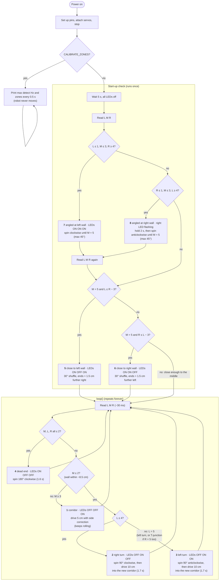
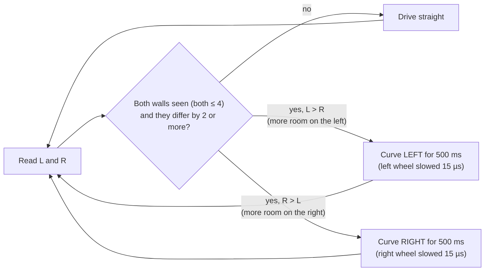

# What the robot does in each case — `ESSENTIAL.ino`

This walks through what the robot **physically does** for every scenario code with the constants currently
in `ESSENTIAL.ino`, so you can picture it on the bench and spot what to fix.

- **Times** come straight from the constants and are exact.
- **Distances and angles** assume `FORWARD_MS_PER_CM` (75) and `TURN_TIME` (580 ms = 90°) are calibrated.
- Readings are written `L M R` (left, middle/front, right zone). Example: `L2 M5 R3`.

---

## Activity diagram

Everything the robot does from power-on, with the current thresholds. Diamonds are checks on the zone
readings, and the first "yes" wins. Codes 5–8 are only checked at start-up; after that the robot stays in
`loop()` and only ever picks codes 1–4.



> GitHub renders the `mermaid` block as a diagram. In VS Code, the built-in Markdown preview needs the
> *Markdown Preview Mermaid Support* extension to draw it.

---

## Zones in centimetres

`irDistance()` tries the 5 frequencies in `ZONE_FREQS` and counts how many miss the wall, giving a zone
from 0 (very close) to 5 (nothing seen). Each frequency sets one zone boundary, chosen so zones 1–4 are
equally wide:

| Zone | 0 | 1 | 2 | 3 | 4 | 5 |
|---|---|---|---|---|---|---|
| distance | ≤ 6.0 cm | 6.0–7.25 cm | 7.25–8.5 cm | 8.5–9.75 cm | 9.75–11 cm | > 11 cm (nothing) |

- The current frequencies are **estimates** from the template's lab measurement. Set `CALIBRATE_ZONES = true`,
  hold a wall at 11, 9.75, 8.5, 7.25 and 6.0 cm, and copy the printed frequencies into `ZONE_FREQS`.
- One table is shared by all three sensors. If calibration prints very different frequencies for L, M and R,
  the sensors need their own tables.
- The sensors are still **blind beyond ~11 cm**: a wall 12 cm away and a wall 1 m away both read 5.

---

## Power-on

1. Pins are set up, the servos attach and receive the stop values.
2. The robot sits still for **5 s** (`STARTUP_DELAY`). **All LEDs stay off**, because no code has been shown yet.
3. **Start-up check, once only:** the sensors are read and `classifyStartup()` checks for codes 7, 8, 5, 6
   (in that order).
   - **7 or 8:** the robot straightens up, then reads the sensors again and runs the code 5/6 check from
     its new position. If it is still too close to one wall, it does that shuffle as well.
   - **5 or 6:** the robot does the shuffle.
   - **None match:** nothing happens.
4. `loop()` starts and keeps running until the power goes off. It only ever picks codes 1–4.

## One pass of `loop()`

```
read 3 sensors (~30 ms) ─► pick a code 1–4 ─► LEDs show it ─► run that code's move ─► repeat
```

- **No memory** between passes, except a side correction that is still running (see below).
- **During the ~30 ms sensor read**, the wheels keep doing whatever they were last told: still rolling
  after codes 1, 2 and 3, stopped after code 4.
- **The LEDs change at the start of the move and the robot moves straight away.** Only code 8 holds
  still first (for 2 s). Nothing else keeps the robot stationary while its code is shown.

## Side correction while driving (codes 1, 2, 3)

Whenever the robot drives forward in `loop()` (the 5 cm step of code 1, and the 10 cm drive into the new
corridor after codes 2 and 3):

1. Read left and right.
2. If **both** walls are seen (neither reads 5) and they differ by **2 zones or more** (≈ 2.5 cm), curve
   towards the further wall for **500 ms** (inside wheel slowed by `STEER_AMOUNT`, 15 µs).
3. Then drive straight and check again.



- A correction that is still running carries on into the next forward drive.
- Any stop (the start of a turn) cancels it.
- A side reading 5 is treated as an opening, so the robot never steers into a gap. This also means it
  drives straight for the first part of the 10 cm after a turn, while one side still looks back down the
  old corridor.

---

## Which code wins

**At start-up** (once): `7 angled L → 8 angled R → 5 close L → 6 close R → nothing`.
After 7 or 8, the `5 → 6` check runs once more.

**Every pass of `loop()`**: `4 dead end → 2 right turn → 3 left turn → T-junction (= 3) → 1 corridor`

| Code | LEDs (L M R) | When checked | Fires when (current thresholds) | Move | Takes | Net result |
|---|---|---|---|---|---|---|
| 7 | ON ON ON | start-up | L 0–1, M 0–3, R 4–5 | spin clockwise until M = 5 (max 45°), then the 5/6 check | ≤ 0.7 s (+ 1.8 s if it shuffles) | roughly parallel, nudged off the left wall if needed |
| 8 | OFF OFF FLASH | start-up | R 0–1, M 0–3, L 4–5 | wait 2 s, spin anticlockwise until M = 5 (max 45°), then the 5/6 check | ≤ 2.7 s (+ 1.8 s if it shuffles) | roughly parallel, nudged off the right wall if needed |
| 5 | ON OFF ON | start-up, and after 7/8 | M = 5, L at least 3 zones below R | 30° shuffle away from left wall | 1.8 s | ≈ 1.5 cm right, 0 cm forward |
| 6 | ON ON OFF | start-up, and after 7/8 | M = 5, R at least 3 zones below L | 30° shuffle away from right wall | 1.8 s | ≈ 1.5 cm left, 0 cm forward |
| 4 | ON OFF OFF | loop | M, L, R **all** 0–2 | spin 180° clockwise | 1.6 s | same spot, facing back out |
| 2 | OFF ON OFF | loop | M 0–2 and L 0–4 *(if 4 didn't match)* | spin 90° clockwise, drive 10 cm | 1.7 s | 10 cm into the right-hand corridor, **still rolling** |
| 3 | OFF ON ON | loop | M 0–2, **L = 5** (any R, so this includes a T-junction) | spin 90° anticlockwise, drive 10 cm | 1.7 s | 10 cm into the left-hand corridor, **still rolling** |
| 1 | OFF OFF ON | loop | M 3–5 (sides don't matter) | drive 5 cm with side correction | 0.4 s | 5 cm further on, **still rolling** |
| 0 | OFF OFF OFF | loop | never, with the current thresholds | stop | — | only if the thresholds are changed to leave a gap |

The 10 cm drive into a new corridor is `TURN_ENTER_CM`. It is a first guess: tune it so the robot ends up
with a wall on both sides of the new corridor.

---

## What each move looks like (top-down)

`#` and `|` are walls. `^ > < v` show which way the robot's nose points. `\` and `/` mean the nose is
angled up-left or up-right.

### Start-up only

```
CODE 7  angled at left wall: spin clockwise until the front is clear (max 45°),
        then check codes 5/6 and shuffle off the wall if still too close

    before            straightened        after 5/6 check (if needed)
  |         |       |         |         |         |
  | \       |       | ^       |         |  ^      |
  |         |       |         |         |         |
```

```
CODE 8  angled at right wall: hold 2 s (right LED flashes), spin anticlockwise until the front is clear,
        then check codes 5/6 and shuffle off the wall if still too close

    before            straightened        after 5/6 check (if needed)
  |         |       |         |         |         |
  |       / |       |       ^ |         |      ^  |
  |         |       |         |         |         |
```

```
CODE 5  close to left wall: 30° shuffle, 1.8 s

       before                  after
  | ^       :       |     |    ^    :       |
  |         :       |     |         :       |
  left   centre   right

  1. spin 30° clockwise     2. drive 3 cm on the angle     3. spin 30° back to straight
  4. reverse 2.6 cm  ->  same spot along the corridor, ≈ 1.5 cm further right
```

```
CODE 6  close to right wall: mirror of code 5, ends ≈ 1.5 cm further left
```

### Every pass of `loop()`

```
CODE 1  corridor: 5 cm forward, correcting sideways, never stops between steps

  |    ^    |
  |    :    |   one step = 5 cm (375 ms)
  |    ^    |
```

```
CODE 2  right turn: spin 90° clockwise on the spot, then drive 10 cm into the new corridor, 1.7 s

    before              turned              after
  ##########          ##########          ##########
  #                   #                   #
  #   ^               #   >               #       > ...
  #     #####         #     #####         #     #####
  #     #             #     #             #     #
```

```
CODE 3  left turn: spin 90° anticlockwise on the spot, then drive 10 cm into the new corridor, 1.7 s

    before              turned              after
  ##########          ##########          ##########
           #                   #                   #
       ^   #               <   #        ... <      #
  #####    #          #####    #          #####    #
      #    #              #    #              #    #
```

```
T-JUNCTION  wall ahead, nothing seen either side: treated as code 3 (LEDs OFF ON ON), takes the left turn

    before                      after
  #################          #################
                                  
        ^                      ... <
  #####     #####            #####     #####
      #     #                    #     #
```

```
CODE 4  dead end: spin 180° clockwise on the spot, 1.6 s

    before          after
  #########       #########
  #   ^   #       #   v   #
  #       #       #       #
```
